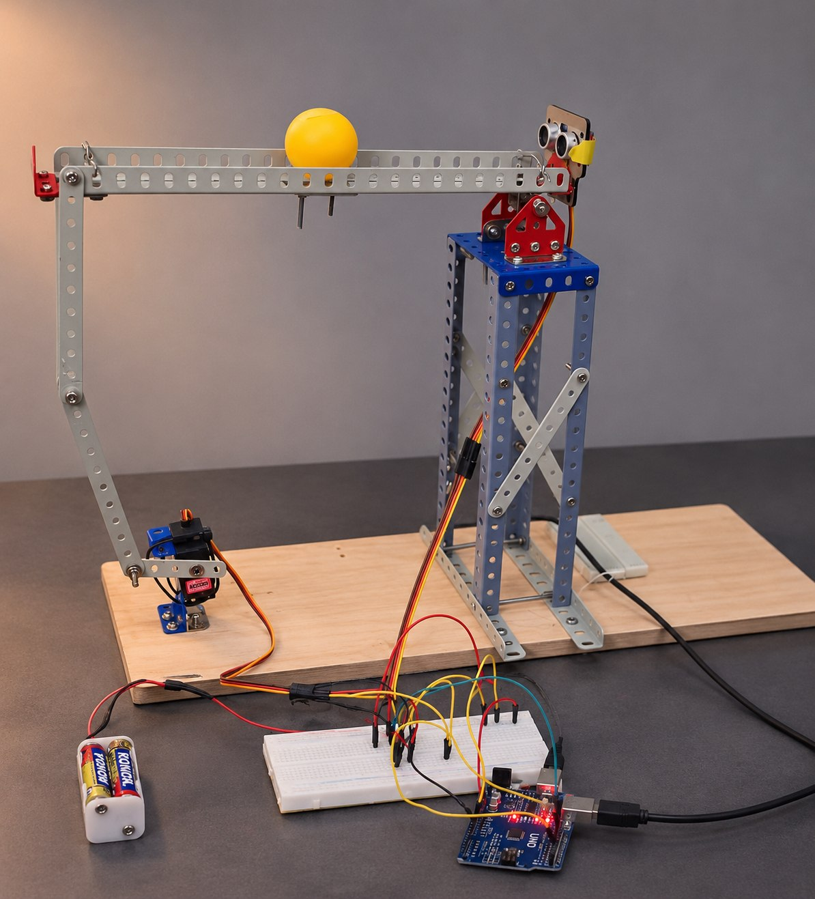
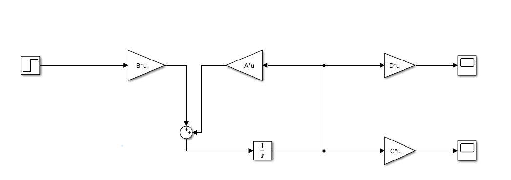
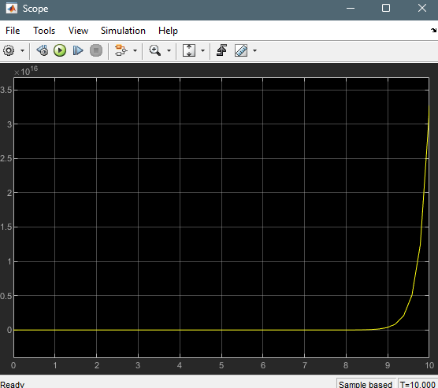
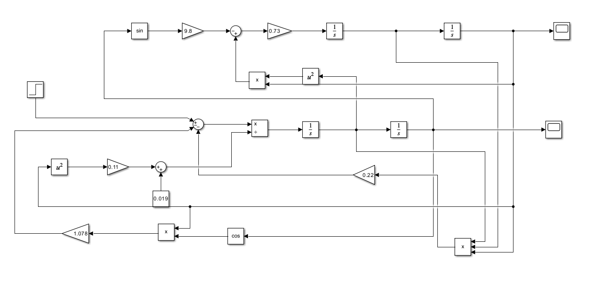
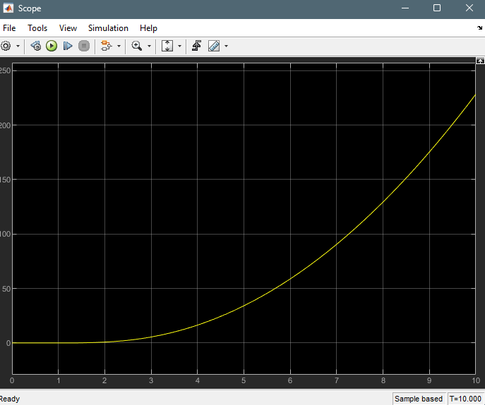
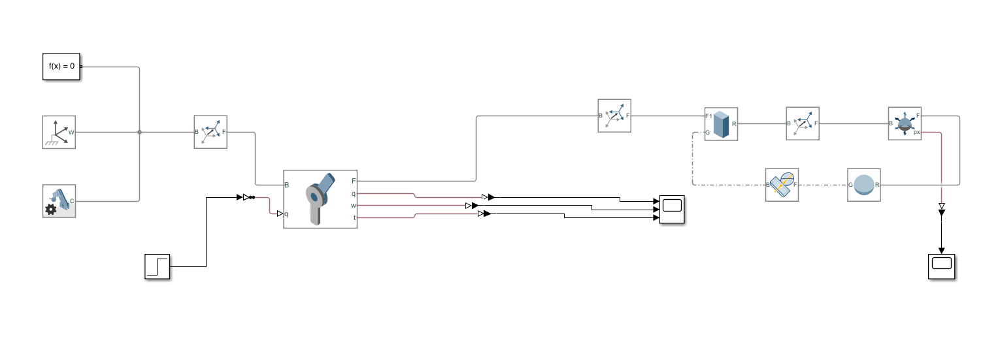
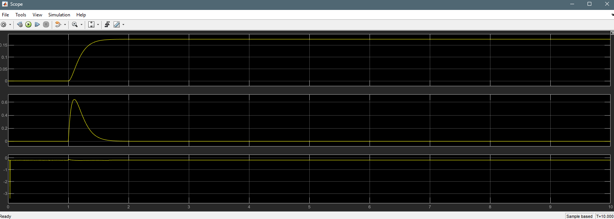
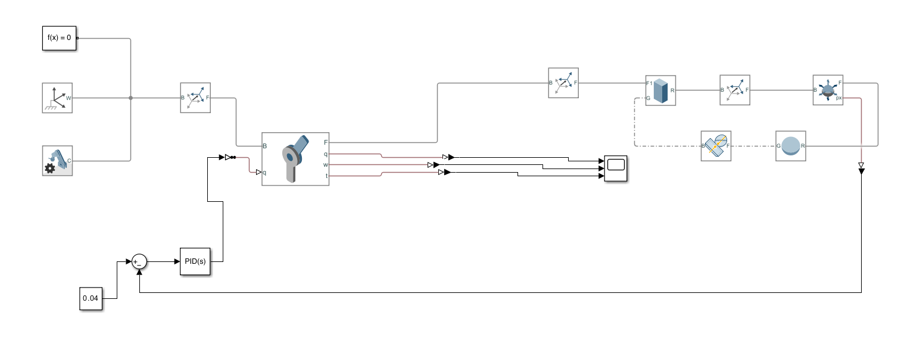
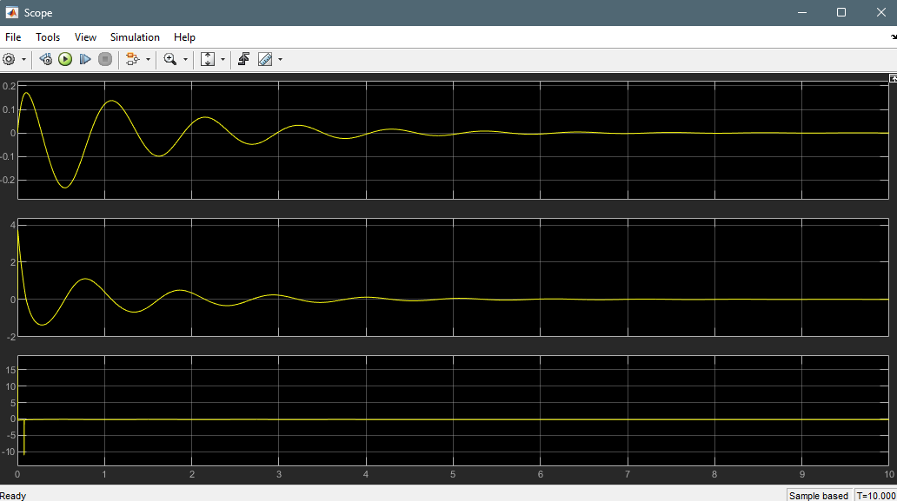
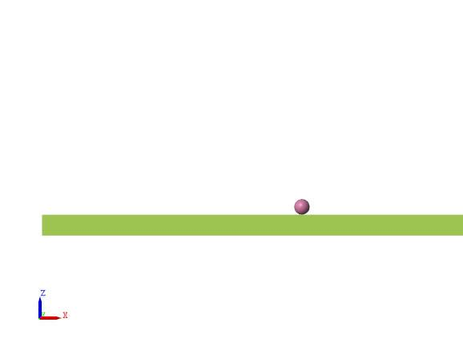

# Ball and Beam Control System

**Mathematical modeling · Simulink simulations · Simscape Multibody · PID experiments · Arduino-based hardware prototype**

This repository documents an educational **ball-and-beam control project**, covering a mathematical model, linear and nonlinear Simulink experiments, Simscape Multibody modeling, controller experiments, and an assembled physical prototype. The original simulation models and video recordings are preserved as project evidence.

> **Project scope:** This educational prototype integrates mathematical modeling, simulation, PID tuning experiments and an Arduino-based mechanism. Controller performance varies across the models and operating conditions; some experimental runs show oscillations and sensitivity to tuning. Quantitative hardware tracking metrics have not yet been established, and a standalone Arduino firmware file was not included in the archived materials.


## Project at a glance

| Area | Included evidence |
| --- | --- |
| Modeling | Linear and nonlinear Simulink files; MATLAB state-space script |
| Mechanical simulation | Simscape Multibody model |
| Controller experiments | Linear, nonlinear, and Multibody PID model variants |
| Physical prototype | Video recordings of the assembled ball-and-beam apparatus |
| Validation | Original response screenshots and discussion of limitations |

## Hardware prototype



*Presentation image: the background and tabletop were digitally refined for readability. The experimental recordings linked below document the apparatus and its operation.*

The supplied report describes an **Arduino Uno**, an **MG996R servo**, and an **HY-SRF05 ultrasonic distance sensor**, together with a metal beam and mechanical linkage. The displayed image is a presentation edit and does not represent an additional laboratory test. The report gives inconsistent beam dimensions; treat those dimensions as **unverified** until measured directly.

[Hardware recording 1](media/videos/hardware_recording_01.mp4) · [Hardware recording 2](media/videos/hardware_recording_02.mp4) · [Hardware recording 3](media/videos/hardware_recording_03.mp4)

## Mathematical model and linearization

The ball position is affected by beam angle, gravity, rotational inertia, rolling behavior, and mechanical constraints. The original report develops the nonlinear model and presents linearization around an equilibrium configuration. The accompanying state-space MATLAB script contains the following numeric example:

```math
\dot{x}=Ax+Bu,\qquad y=Cx+Du
```

```math
A=\begin{bmatrix}0&1&0&0\\0&0&-7&0\\0&0&0&1\\-56.8&0&0&0\end{bmatrix},\quad
B=\begin{bmatrix}0\\0\\0\\52.6\end{bmatrix},\quad
C=\begin{bmatrix}1&0&0&0\end{bmatrix}

```


The original source defines a **1×4** `D` vector (`[0 0 1 0]`), which is **not dimensionally compatible** with a one-output, one-input state-space realization. The uploaded script is deliberately retained unchanged; this model must be checked before relying on numerical simulation or controller design. See [validation notes](docs/VALIDATION.md).

## 1. Linear model



The open-loop response figure illustrates the model's transient behavior and motivates investigating feedback control.



**Source models:** [`linear_model.slx`](models/linear/linear_model.slx) and [`linear_model_alternative.slx`](models/linear/linear_model_alternative.slx)

## 2. Nonlinear model



The nonlinear model includes trigonometric terms and is intended to capture behavior outside a purely local linear approximation. The response varies with assumptions and input conditions.



**Source model:** [`nonlinear_model.slx`](models/nonlinear/nonlinear_model.slx)

## 3. Simscape Multibody model



Simscape Multibody provides a mechanism-oriented representation. The original report notes closer qualitative agreement in ball-position trends between the Multibody and nonlinear models, while angular trajectories differed.



**Source model:** [`multibody_model.slx`](models/multibody/multibody_model.slx)

## 4. PID controller experiments

PID-controlled variants exist for all three modeling approaches. The trials illustrate how controller tuning depends on model fidelity and operating conditions. The linear and nonlinear responses exhibit sensitivity and limited stability in the recorded settings, whereas the Multibody PID variant displays a more favorable simulated transient. These observations are qualitative and should not be interpreted as universal performance guarantees.





| Variant | Source model | Reported observation |
| --- | --- | --- |
| Linear + PID | [`linear_pid.slx`](models/pid/linear_pid.slx) | Position regulation was sensitive to tuning in the recorded trial |
| Nonlinear + PID | [`nonlinear_pid.slx`](models/pid/nonlinear_pid.slx) | Oscillations and limited stability appeared for the recorded parameters |
| Multibody + PID | [`multibody_pid.slx`](models/multibody/multibody_pid.slx) | More promising simulated transient behavior; quantitative criteria not verified |

## Simulation recordings

The three original simulation recordings are included as supplemental source evidence:

[Simulation recording 1](media/videos/simulation_recording_01.avi) · [Simulation recording 2](media/videos/simulation_recording_02.avi) · [Simulation recording 3](media/videos/simulation_recording_03.avi)



## Repository layout

```text
ball-and-beam-control-system/
├── README.md
├── .gitignore
├── matlab/
│   └── linear_state_space_original.m
├── models/
│   ├── linear/
│   ├── nonlinear/
│   ├── pid/
│   └── multibody/
├── docs/
│   ├── images/
│   ├── TECHNICAL_REPORT.md
│   ├── VALIDATION.md
│   └── MODEL_INDEX.md
└── media/
    └── videos/
```

## Open and run the models

1. Install a compatible version of **MATLAB and Simulink**. Multibody examples additionally require **Simscape Multibody** and any dependencies referenced inside the original files.
2. Download or clone this repository.
3. Open each `.slx` model from `models/` in MATLAB/Simulink.
4. Inspect model configuration, solver, initial conditions, and workspace variables before running it. Some models can depend on parameters not bundled in this repository.
5. For the linear scripts, inspect `matlab/linear_state_space_original.m` before use; it contains a state-space matrix-dimension inconsistency documented below.
6. Treat graphical screenshots as evidence of earlier runs, not verification of reproducibility on new systems.

## Documentation

- [Technical project report (PDF)](docs/BALL_AND_BEAM_TECHNICAL_REPORT.pdf) — formatted engineering write-up for portfolio review
- [Technical project report (Markdown)](docs/TECHNICAL_REPORT.md) — editable report with methodology, observations, and engineering analysis
- [Model index](docs/MODEL_INDEX.md) — what each model represents
- [Validation checklist and issues](docs/VALIDATION.md) — what is supported by source evidence and what must still be tested

## Current limitations and potential improvements

- Resolve matrix dimensions and verify source parameters against the derived physics.
- Reproduce linear, nonlinear, and Multibody trajectories under consistent initial conditions.
- Use measured rise time, settling time, overshoot, and tracking error to compare controllers.
- Supply and test the original Arduino firmware if publication rights permit.
- Measure sample time, servo saturation, sensor noise, and safety limitations on the prototype.
- Reconcile conflicting geometric dimensions in the original reports.

## Attribution and license

This portfolio repository is an English presentation of the author's project, including original source files and separately prepared explanatory material. Collaborator contributions and third-party resources should be acknowledged wherever applicable. The original coursework report is not redistributed. **No open-source license has been selected.**
