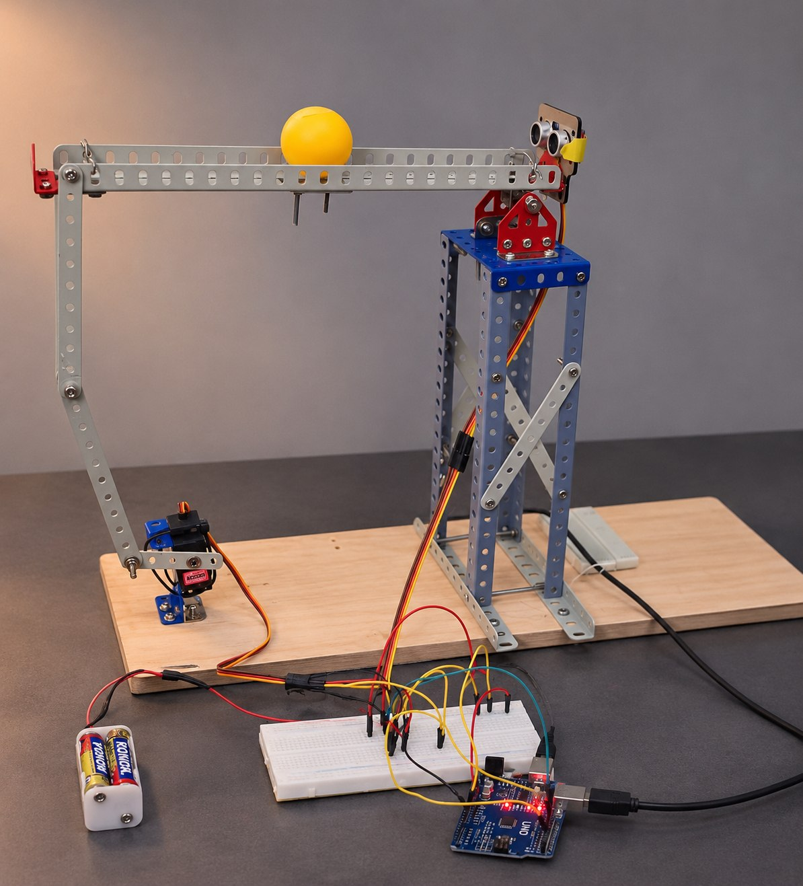
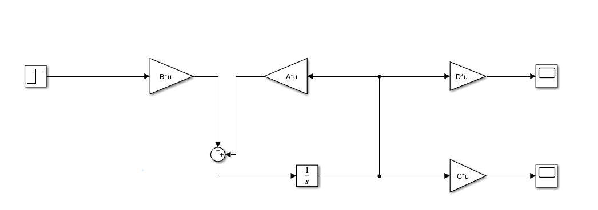
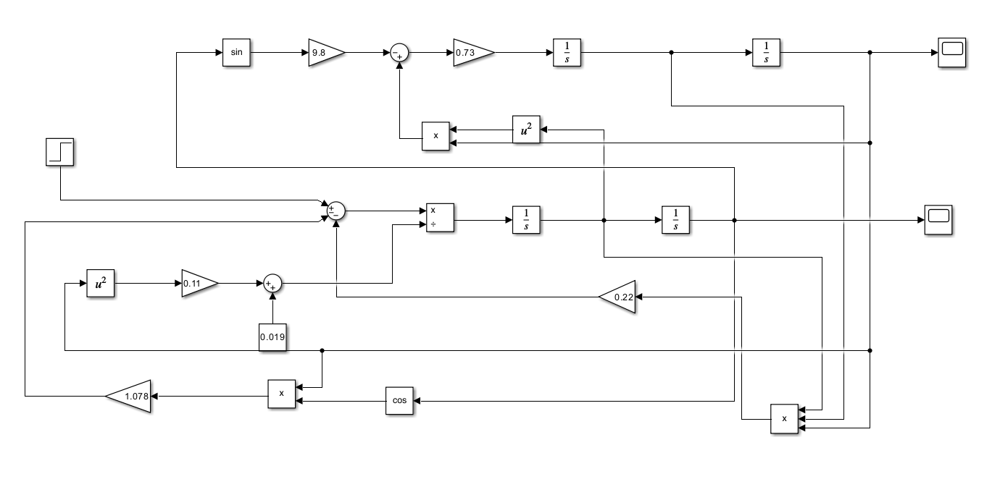
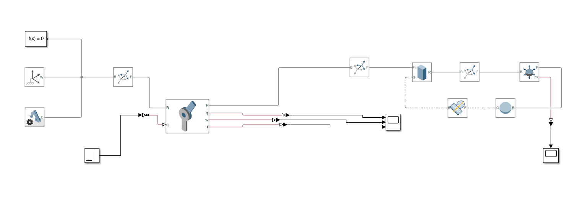
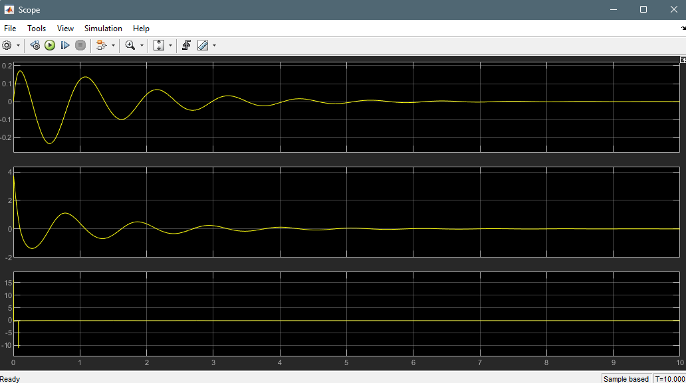

# Technical Report — Ball and Beam Control System

**Project lead, principal developer and primary technical author:** hanahmdi  
**Discipline:** Control Engineering  
**Project type:** Mathematical modeling, simulation, PID experiments and physical prototype  
**Evidence status:** Technical analysis based on supplied model files, screenshots and recorded demonstrations; not a new series of measured laboratory trials.

## Abstract

This project investigates a ball-and-beam apparatus using complementary linear, nonlinear and Simscape Multibody models and exploratory PID feedback control. A physical mechanism was assembled using an Arduino Uno, servo actuator, ultrasonic ranging sensor, mechanical beam and linkage. Original model files and video records document design iterations. The simulation responses reveal sensitivity to model assumptions and controller tuning; among the supplied trials, the Multibody PID configuration demonstrated comparatively more favorable qualitative behavior. Repeatable settling time, tracking-error and robustness benchmarks remain future validation tasks.



*Figure 1. Presentation image with digitally simplified background. Original experimental videos are retained separately as project records.*

## 1. Objectives and deliverables

The project's scope covers: (i) a mathematical description of ball motion, (ii) linear and nonlinear block-diagram simulations, (iii) multibody mechanism simulation, (iv) exploratory PID tuning and response comparison, and (v) a physical Arduino-based prototype. This repository includes seven original Simulink models, one MATLAB matrix script, screenshots and video footage. A standalone Arduino sketch was not present in the original supplied archives; wiring and controller firmware therefore cannot be reproduced solely from this repository.

## 2. Apparatus and instrumentation

The physical prototype uses a metal beam with a rolling ball, a jointed mechanical support, actuator linkage and a servo-driven beam angle. The project documentation identifies an **Arduino Uno**, **MG996R servomotor**, and **HY-SRF05 ultrasonic distance sensor**. The visual records support the presence of the assembled apparatus and connecting electronics. The reported beam dimensions differ across source sections (24 cm versus 45 cm), so no measured geometric value is asserted here.

## 3. Dynamic-model foundations

For a ball rolling without slip on a beam, a commonly used *idealized* model assumes a rigid beam, a spherical ball, negligible rolling resistance, and a controllable inclination angle alpha. With ball mass m, radius r and rotational inertia J, an illustrative equation along the beam is:

```math
\left(m+\frac{J}{r^2}\right)\ddot{x}=mg\sin\alpha
```

For a uniform solid sphere, J = 2 m r^2 / 5. For small angles about a horizontal beam, sin(alpha) is approximately alpha, yielding:

```math
\ddot{x}\approx\frac{5g}{7}\alpha
```

**Modeling note:** These equations are theoretical context, not a claim that every source `.slx` file implements precisely this idealization. Real servo dynamics, geometry, pivot coupling, backlash, sensor noise and saturation can change the system response. Source model equations and parameter values should be verified before quantitative comparison.

## 4. Modeling approaches

### 4.1 Linear approximation

A local model around the horizontal operating point offers a convenient setting for interpreting poles, controllability and feedback. The retained MATLAB state-space example includes A (4x4), B (4x1), C (1x4) but defines **D as 1x4**. For a single input and single output, D should be 1x1; this is an identified dimension mismatch, not evidence of a confirmed executable state-space realization.



*Figure 2. Original linear Simulink block diagram.*

### 4.2 Nonlinear model

The nonlinear Simulink implementation retains trigonometric and coupling behavior. It is useful for checking whether design conclusions made from local linearization carry over to larger deflections, but matched-input numerical comparisons have not yet been established.



*Figure 3. Nonlinear model as supplied.*

### 4.3 Simscape Multibody representation

The Multibody model provides a mechanical representation of bodies, joints and motion. It supports a more geometric view than a standalone transfer function or state-space approximation. The supplied report describes qualitative similarity in some position trends between the Multibody and nonlinear results, with differences in the angular trajectories.



*Figure 4. Simscape Multibody representation.*

## 5. Control implementation and observations

The archive includes PID-based variants for the linear, nonlinear and Multibody models. The available recorded runs suggest that **regulation was sensitive to controller tuning and operating conditions**, particularly for the linear and nonlinear cases. The Multibody PID configuration exhibited a comparatively encouraging simulated transient. The evidence does not justify fixed claims about exact overshoot, settling time or persistent balancing performance.



*Figure 5. Recorded Multibody PID responses. Axis values and controller settings should be inspected in the original model before quantitative reporting.*

The appropriate next comparison would apply a common setpoint, matched initial ball positions, consistent units and identical reporting windows, then extract rise time, peak excursion, settling time, integrated absolute error (IAE), and maximum actuator command.

## 6. Physical-prototype demonstration

Three recordings document the assembled mechanism. The physical build demonstrates integration of structure, actuator, electronics and sensing. The videos are evidence of the build and experimental activity; they are **not sufficient by themselves to establish repeatable reference tracking** over different initial positions or disturbances. A future reproducibility package should include the original Arduino firmware, wiring/pin table, sample rate, controller gains and raw logged position traces.

## 7. Technical evaluation and lessons learned

A key lesson is that different model fidelities can produce different responses to the same nominal control strategy. Translating a continuous-time controller to hardware adds sampling delays, actuator limits and noisy sensing. This project illustrates an end-to-end engineering effort, while identifying useful next steps: reconcile geometric parameters, fix the state-space D dimension, document dependencies, and test controller robustness with reproducible signals.

## 8. Validation roadmap

| Item | Current evidence | Recommended verification |
| --- | --- | --- |
| Mathematical models | `.slx` files and diagrams | Re-run with documented solver and initial conditions |
| State-space script | Source MATLAB matrix file | Correct D dimensions, validate linearization |
| PID trials | Simulated model variants and plots | Report gains, sampling, rise/settling times and IAE |
| Hardware assembly | Original project video recordings | Provide measured beam dimensions and wiring diagram |
| Arduino firmware | Not present as standalone source | Recover/inspect sketch and record serial/sensor data |
| Stability and robustness | Qualitative responses only | Multiple initial conditions, repeatability trials and disturbances |

## 9. Conclusion

The work presents a practical foundation spanning modeling, simulation, PID experimentation and a constructed ball-and-beam platform. Its greatest portfolio strength is the combination of a physical build and multiple modeling approaches. The remaining performance questions are well-defined engineering validation tasks rather than reasons to omit the project from a technical portfolio.

## Source and attribution notes

Project lead, principal developer and primary technical author: **hanahmdi** (as identified by the project owner). Source models and video material were supplied by the project owner; the English report has been newly prepared from those sources. All theoretical contextual equations are presented as assumptions for discussion. This document does not invent hardware performance measurements or imply that currently unverified code was executed.
